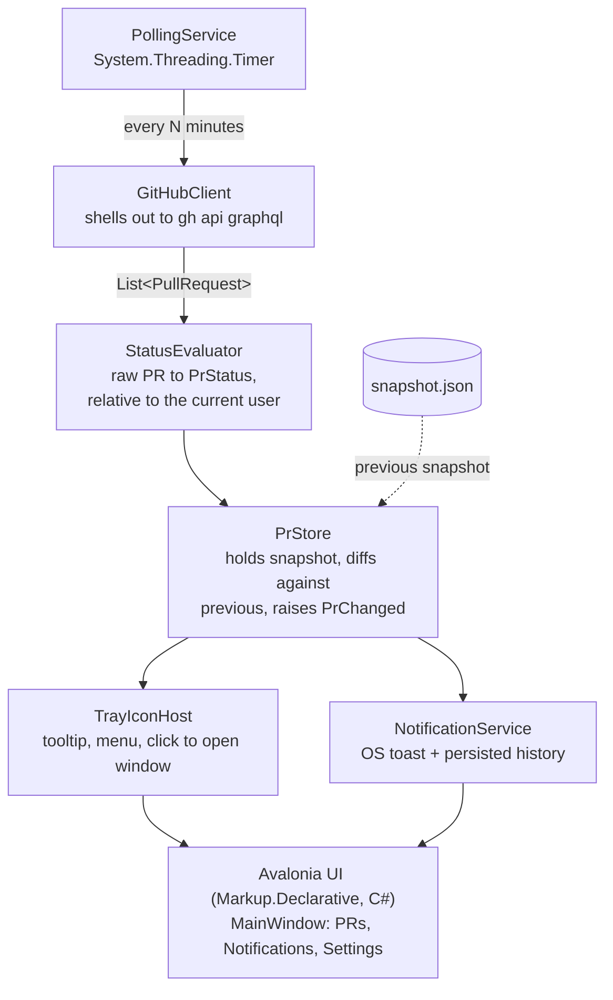

# Architecture & Plan

**GitHub PR Status Tracker** — a tray app that shows which pull requests are waiting on you.

This is a deliberately small app. The architecture below is intentionally light: one
process, one background poller, one in-memory state object, a few JSON files on disk.
There is no database, no plugin system, and no service layer beyond what is described here.

---

## 1. Shape of the app



Everything runs in one process. The poller is the only writer of app state; the UI reads
it and reacts to change events.

---

## 2. Project layout

```
src/PrStatusTracker/
  Program.cs                  // Avalonia entry point, single-instance guard
  App.cs                      // app lifetime, tray setup, wiring
  Models/
    PullRequest.cs            // raw data from GitHub
    PrStatus.cs               // status enum + bucket
    NotificationRecord.cs
    AppSettings.cs
  GitHub/
    GhCommandRunner.cs        // Process wrapper around the `gh` executable
    GitHubClient.cs           // queries + JSON to models
    Queries.cs                // the GraphQL document as a const string
  Core/
    StatusEvaluator.cs        // the rules in section 4
    PrStore.cs                // snapshot + diffing
    PollingService.cs
    JsonFileStore.cs          // load/save for settings, snapshot, notifications
  Notifications/
    INotifier.cs
    WindowsNotifier.cs
    MacNotifier.cs
    NotificationService.cs    // dedupe, persist, dispatch
  Platform/
    IAutoStart.cs
    WindowsAutoStart.cs       // HKCU Run key
    MacAutoStart.cs           // ~/Library/LaunchAgents plist
  Views/
    MainWindow.cs             // Avalonia.Markup.Declarative
    PrListView.cs
    NotificationsView.cs
    SettingsView.cs
  ViewModels/
    MainViewModel.cs
tests/PrStatusTracker.Tests/
  StatusEvaluatorTests.cs     // the rules table, exercised against fixture JSON
  PrStoreDiffTests.cs
```

**Wiring:** plain constructor injection, composed by hand in `App.cs`. No DI container —
there are about a dozen objects.

---

## 3. GitHub access via `gh`

All GitHub access goes through the `gh` CLI. The app never handles a token: `gh` already
holds the user's credentials, refreshes them, and respects their enterprise host config.

`GhCommandRunner` is a thin `Process` wrapper:

- Resolves the `gh` executable (`PATH`, then the usual install locations:
  `C:\Program Files\GitHub CLI\gh.exe`, `/opt/homebrew/bin/gh`, `/usr/local/bin/gh`).
- Runs with redirected stdout/stderr, no shell, a cancellation token, and a timeout.
- On non-zero exit, surfaces a typed failure. The three cases the UI cares about are
  **gh not installed**, **not authenticated** (`gh auth status` fails), and
  **rate limited / network error**. Each maps to a specific banner in the window rather
  than a generic error.

### The one query

A single `gh api graphql` call fetches both lists, using two `search` aliases in one
document. The viewer's login is fetched once at startup (`viewer { login }`) and cached,
since GraphQL search does not accept `@me`.

```graphql
query($reviewQ: String!, $authoredQ: String!) {
  viewer { login }
  review:   search(query: $reviewQ,   type: ISSUE, first: 50) { nodes { ...PrFields } }
  authored: search(query: $authoredQ, type: ISSUE, first: 50) { nodes { ...PrFields } }
}

fragment PrFields on PullRequest {
  number title url isDraft createdAt updatedAt
  author { login }
  repository { nameWithOwner }
  reviewDecision                 # APPROVED | CHANGES_REQUESTED | REVIEW_REQUIRED | null
  mergeable                      # MERGEABLE | CONFLICTING | UNKNOWN
  reviewRequests(first: 20) { nodes { requestedReviewer {
    ... on User { login }
    ... on Team { name }
  } } }
  latestReviews(first: 20) { nodes { author { login } state submittedAt } }
  commits(last: 1) { nodes { commit {
    pushedDate
    statusCheckRollup { state } # SUCCESS | FAILURE | PENDING | ERROR | EXPECTED
  } } }
}
```

with

- `reviewQ`   = `is:open is:pr review-requested:<login> archived:false`
- `authoredQ` = `is:open is:pr author:<login> archived:false`

One call per poll keeps us well inside the GraphQL rate limit even at a one-minute
interval.

**Polling:** default every **2 minutes**, configurable (minimum 1 minute), plus a manual
*Refresh* in the tray menu. Failures back off exponentially up to 15 minutes and the tray
icon switches to its error variant; a success resets the backoff.

**Actions** (opening a PR, and later approving or commenting) also go through `gh` —
`gh pr view --web`, `gh pr review`.

---

## 4. Status model

Each PR is reduced to one `PrStatus`, always expressed *relative to the current user*, and
each status belongs to a bucket that drives grouping and colour in the UI.

### PRs where you are a requested reviewer

| Condition | Status | Bucket |
|---|---|---|
| Draft | `ReviewerDraft` | Waiting on others |
| You have not reviewed since the last push | `AwaitingYourReview` | **Needs you** |
| Review re-requested from you after you reviewed | `AwaitingYourRereview` | **Needs you** |
| Your latest review is `CHANGES_REQUESTED` | `YouRequestedChanges` | Waiting on others |
| Your latest review is `APPROVED` | `YouApproved` | Waiting on others |

### PRs you authored

| Condition (first match wins) | Status | Bucket |
|---|---|---|
| Draft | `Draft` | Waiting on others |
| `mergeable == CONFLICTING` | `MergeConflict` | **Needs you** |
| Checks rollup is `FAILURE` or `ERROR` | `ChecksFailing` | **Needs you** |
| `reviewDecision == CHANGES_REQUESTED` | `ChangesRequested` | **Needs you** |
| `reviewDecision == APPROVED`, checks green | `ReadyToMerge` | **Ready to merge** |
| `reviewDecision == APPROVED`, checks pending | `ApprovedChecksPending` | Waiting on others |
| Reviewers requested, none have responded | `AwaitingReview` | Waiting on others |
| No reviewers requested | `NoReviewers` | **Needs you** |

A PR that appears in both lists (you authored it *and* were asked to review it) is shown
once, under the authored rules.

"You have not reviewed since the last push" compares your latest review's `submittedAt`
against the head commit's `pushedDate`. That comparison is what moves a PR back into
**Needs you** when new commits land, instead of leaving it stale at "you approved".

The three buckets — **Needs you**, **Waiting on others**, **Ready to merge** — are the
whole product in one line: the tray tooltip is just their counts.

---

## 5. Change detection & notifications

`PrStore` holds the current snapshot keyed by `repo#number`. After each poll it diffs the
new snapshot against the previous one and emits a change for:

- a PR **appearing** in either list (new review request, new PR of yours),
- a PR's **status changing** (`AwaitingReview` to `ChangesRequested`, `ChecksFailing` to
  `ReadyToMerge`, and so on),
- a PR **disappearing** (merged or closed, reported as one closing notification).

Rules that keep the noise down:

- The **first poll after launch is silent**. It seeds from the snapshot on disk, and only
  differences against that persisted snapshot notify.
- Only transitions *into* a notable status notify. Repeated polls with an unchanged status
  are silent.
- Status changes on a PR you have **snoozed** are recorded in history but do not toast.

### Toasts

`INotifier.ShowAsync(NotificationRecord)` has one implementation per OS:

- **Windows** — `CommunityToolkit.WinUI.Notifications` (`ToastContentBuilder`), which needs
  a registered AUMID and a Start Menu shortcut; the installer creates both. The activation
  payload carries the PR URL.
- **macOS** — `UNUserNotificationCenter` through Objective-C interop, with a fallback to
  `osascript -e "display notification ..."` when the app is not running from a signed
  `.app` bundle, which `UNUserNotificationCenter` requires.

Clicking a toast opens the PR in the browser via `gh pr view --web`.

### Persistence

Three JSON files under the platform app-data directory
(`%LOCALAPPDATA%\PrStatusTracker\` on Windows,
`~/Library/Application Support/PrStatusTracker/` on macOS):

| File | Contents |
|---|---|
| `settings.json` | poll interval, start-at-login, notification prefs, snoozed PRs |
| `notifications.json` | rolling history, capped at 200: `Id`, `PrKey`, `Title`, `Body`, `Url`, `Timestamp`, `Dismissed` |
| `snapshot.json` | last PR snapshot, so a restart does not re-notify everything |

Writes are atomic (write to `.tmp`, then replace). A corrupt file is renamed aside and
recreated from defaults rather than crashing the app.

---

## 6. UI

Avalonia with **Avalonia.Markup.Declarative** — views are C# methods returning a control
tree; no XAML and no `.axaml` files in the project.

**Tray icon** — Avalonia's built-in `TrayIcon`:

- `ToolTipText` is rewritten after every poll with the summary line
  (`3 need you · 2 waiting · 1 ready to merge`). That is the hover behaviour.
- `Clicked` shows and focuses the main window.
- Right-click menu: *Refresh now*, *Open GitHub*, *Settings*, *Quit*.
- The icon has three variants: idle, "needs you" (badged), and error/disconnected.

**Main window** — one window, three tabs:

1. **Pull requests** — grouped by bucket, then sorted oldest-updated first. Each row shows
   a status pill, repo, `#number`, title, author, age, and a checks indicator. Clicking
   opens the PR; a row menu offers *Snooze* and *Copy link*.
2. **Notifications** — the persisted history, newest first, with *Dismiss* and
   *Dismiss all*. Dismissed items hide behind a *Show dismissed* toggle.
3. **Settings** — poll interval, start at login, which transitions should toast, `gh`
   status with a *Re-check* button, and the resolved `gh` path.

Closing the window hides it to the tray; quitting is explicit, from the tray menu.

---

## 7. Start at login

`IAutoStart` with `IsEnabled`, `Enable()`, `Disable()`:

- **Windows** — a value under `HKCU\Software\Microsoft\Windows\CurrentVersion\Run`
  pointing at the executable with a `--tray` argument.
- **macOS** — a LaunchAgent plist at `~/Library/LaunchAgents/com.prstatustracker.plist`
  with `RunAtLoad`, registered and unregistered with `launchctl`.

Both are per-user and need no elevation. The app starts hidden when launched with `--tray`.

---

## 8. Packaging

- **Windows** — self-contained `win-x64` publish wrapped in an installer that creates the
  Start Menu shortcut carrying the AUMID that toasts require.
- **macOS** — `osx-arm64` and `osx-x64` publishes bundled into a signed, notarized `.app`;
  signing is what makes native notifications work.

---

## Implementation plan

Each phase ends with something runnable.

1. **Skeleton** — Avalonia app with Markup.Declarative, tray icon, empty window,
   single-instance guard, hide-to-tray. *Runnable: an icon in the tray.*
2. **`gh` integration** — `GhCommandRunner`, `GitHubClient`, the GraphQL query, the models,
   and the three error cases. *Runnable: the window lists raw PRs.*
3. **Status model** — `StatusEvaluator` plus unit tests over fixture JSON, driven by the
   tables in section 4. *Runnable: PRs grouped into the three buckets.*
4. **Polling & tooltip** — `PollingService`, `PrStore`, backoff, tooltip summary, manual
   refresh. *Runnable: the app is already useful.*
5. **Notifications** — diffing, `NotificationService`, Windows toasts, then macOS toasts,
   persistence, and the Notifications tab. *Runnable: it tells you when things change.*
6. **Settings & autostart** — settings file, settings tab, `IAutoStart` on both platforms.
7. **Packaging** — installer, `.app` bundle, signing and notarization.

### Known unknowns to resolve during implementation

- **Team review requests.** `review-requested:<login>` is expected to cover requests made
  to teams the user belongs to, but that is worth confirming against a real org before
  relying on it. The fallback is a second search using
  `team-review-requested:<org>/<team>`.
- **macOS notifications outside a bundle.** Phase 5 should settle early whether the
  `osascript` fallback is good enough for development builds, since notarization
  (phase 7) is the only route to the real API.
- **`statusCheckRollup` is `null` on PRs with no checks**, which must read as "no checks"
  rather than "failing".
