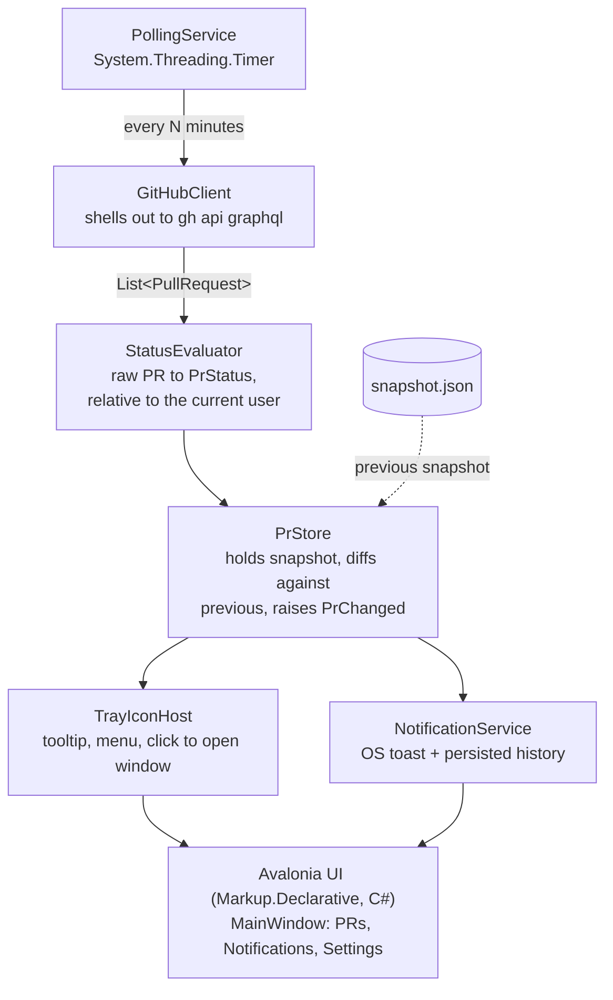
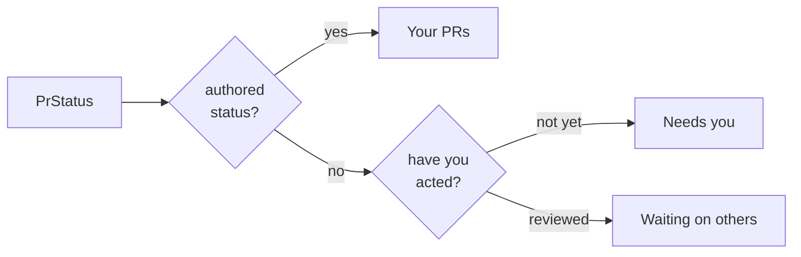

# Architecture & Plan

**GitHub PR Status Tracker** — a tray app that shows which pull requests are waiting on you.

This is a deliberately small app. The architecture below is intentionally light: one
process, one background poller, one in-memory state object, a few JSON files on disk.
There is no database, no plugin system, and no service layer beyond what is described here.

---

## 1. Shape of the app



Everything runs in one process. The poller is the only writer of app state; the UI reads
it and reacts to change events.

---

## 2. Project layout

```
src/PrStatusTracker/
  Program.cs                  // Avalonia entry point, single-instance guard
  App.cs                      // app lifetime, composition root, main window
  Assets/                     // tray icon PNGs: idle, needs-you, ready, error
  Models/
    PullRequest.cs            // raw data from GitHub
    PrStatus.cs               // status enum + bucket + labels
    NotificationRecord.cs
    AppSettings.cs
  GitHub/
    GhCommandRunner.cs        // Process wrapper around the `gh` executable
    GitHubClient.cs           // query + JSON to models
    Queries.cs                // the GraphQL document as a const string
  Core/
    StatusEvaluator.cs        // the rules in section 4
    PrFilter.cs               // main-window filter rules (text + author/label/repo)
    PrStore.cs                // snapshot + diffing
    StarStore.cs              // the PRs you starred, persisted
    PollingService.cs
    UpdateService.cs            // release check + installer handoff, both through `gh`
    JsonFileStore.cs          // load/save for settings, snapshot, notifications
  Notifications/
    INotifier.cs              // + NullNotifier for other platforms
    WindowsNotifier.cs
    MacNotifier.cs
    NotificationService.cs    // filter, persist, dispatch
  Platform/
    IAutoStart.cs             // + Windows (HKCU Run key) and macOS (LaunchAgent) impls
    Browser.cs                // open a URL in the default browser
  Views/
    MainView.cs               // Avalonia.Markup.Declarative; tabs + shared helpers
    PrListView.cs
    NotificationsView.cs
    SettingsView.cs
    TrayIconHost.cs           // tooltip, icon variant, menu
  ViewModels/
    PrFilterViewModel.cs      // one filter bar's state; a tab owns or shares one
    MainViewModel.cs
tests/PrStatusTracker.Tests/
  StatusEvaluatorTests.cs     // the rules tables, case by case
  PrFilterTests.cs
  StarStoreTests.cs
  PrStoreDiffTests.cs
  GitHubClientParseTests.cs   // parsing against Fixtures/graphql-response.json
  NotificationServiceTests.cs
```

**Wiring:** plain constructor injection, composed by hand in `App.cs`. No DI container —
there are about a dozen objects.

---

## 3. GitHub access via `gh`

All GitHub access goes through the `gh` CLI. The app never handles a token: `gh` already
holds the user's credentials, refreshes them, and respects their enterprise host config.

`GhCommandRunner` is a thin `Process` wrapper:

- Resolves the `gh` executable (`PATH`, then the usual install locations:
  `C:\Program Files\GitHub CLI\gh.exe`, `/opt/homebrew/bin/gh`, `/usr/local/bin/gh`).
- Runs with redirected stdout/stderr, no shell, a cancellation token, and a timeout.
- On non-zero exit, surfaces a typed failure. The three cases the UI cares about are
  **gh not installed**, **not authenticated** (exit code 4, or the message says so), and
  **rate limited / network error** (message text). Each maps to a specific banner in the
  window rather than a generic error.

### The queries

One `gh api graphql` call fetches every list we need, using three `search` aliases in
one document. The viewer's login is fetched once at startup (`gh api user`) and cached,
since GraphQL search does not accept `@me`.

```graphql
query($reviewQ: String!, $reviewedQ: String!, $authoredQ: String!) {
  review:   search(query: $reviewQ,   type: ISSUE, first: 50) { nodes { ...PrFields } }
  reviewed: search(query: $reviewedQ, type: ISSUE, first: 50) { nodes { ...PrFields } }
  authored: search(query: $authoredQ, type: ISSUE, first: 50) { nodes { ...PrFields } }
}

fragment PrFields on PullRequest {
  id number title url isDraft createdAt updatedAt additions deletions
  author { login }
  repository { nameWithOwner }
  labels(first: 10) { nodes { name } }
  reviewDecision                 # APPROVED | CHANGES_REQUESTED | REVIEW_REQUIRED | null
  mergeable                      # MERGEABLE | CONFLICTING | UNKNOWN
  reviewRequests(first: 20) { nodes { requestedReviewer {
    ... on User { login }
    ... on Team { name }
  } } }
  latestReviews(first: 20) { nodes { author { login } state submittedAt } }
  commits(last: 1) { nodes { commit {
    committedDate
    statusCheckRollup { state } # SUCCESS | FAILURE | PENDING | ERROR | EXPECTED
  } } }
}

```

Review threads for authored PRs come from a second query, one request for all of them:

```graphql
query($ids: [ID!]!, $cursor: String) {
  nodes(ids: $ids) { ... on PullRequest {
    id
    reviewThreads(first: 50, after: $cursor) {
      pageInfo { hasNextPage endCursor }
      nodes {
        isResolved
        comments(last: 5) { nodes { author { login } state } }
      }
    }
  } }
}
```

with

- `reviewQ`   = `is:open is:pr review-requested:<login> archived:false`
- `reviewedQ` = `is:open is:pr reviewed-by:<login> -author:<login> archived:false`
- `authoredQ` = `is:open is:pr author:<login> archived:false`

`reviewed-by:` is there because GitHub removes a PR from `review-requested:` the moment you
submit a review; without it, approving a PR would look like the PR closing.

Threads are checked only for authored PRs (`Queries.AuthoredAlias`).
`HasOpenThreads` means at least one unresolved review thread has a last submitted reply from
someone other than the author. The author's own pending reply does not count, since the
reviewer has not seen it. Each thread is checked independently, so replying in one cannot hide
work in another. Bot replies count like human replies; outdated threads count until resolved
or answered. Issue comments and standalone review bodies are not threads and never count.

`Queries.ReviewThreads` asks for the first page of every PR at once. A PR whose first page has
no work and more threads is then paged by cursor, alone, until it finds work or runs out. A
failed or missing page fails the poll rather than reporting no work.
Only thread state matters; comment timestamps and local read history are not fetched or stored.

**What a poll costs:** the search is 6 GraphQL points and one `gh` process. The thread query is
one more process and about half a point per PR in it, plus 1 per later page. A PR with nothing
waiting on you is left out for the next `GitHubClient.QuietReuses` polls unless its `updatedAt`
moves, which a new comment or review does. Resolving or reopening a thread is not guaranteed to
move `updatedAt`, so a PR with open threads is checked every poll, and a reopened thread shows
up within `QuietReuses + 1` polls. So a poll costs 6 points, plus about half a point per PR with
open threads, new activity or an expired quiet answer: at most about 31 with 50 authored PRs. The
5,000 points/hour budget belongs to the whole `gh` login, so it is shared with everything else
using it.

**Polling:** default every **2 minutes**, configurable (minimum 1 minute), plus a manual
*Refresh* in the tray menu. Failures double the interval per consecutive failure, capped
at 15 minutes, and the tray icon switches to its error variant; a success resets the
backoff.

**Opening a PR** hands the URL to the OS (`Process.Start` with `UseShellExecute`), which needs
no `gh` round trip. Future write actions (approve, comment) would go through `gh pr review`.

---

## 4. Status model

Each PR is reduced to one `PrStatus`, always expressed *relative to the current user*, and
each status belongs to a bucket that drives grouping and colour in the UI.

The bucket split is simply **whether you wrote it**. Everything you authored lives together in
*Your PRs*, whatever state it is in; the other two tabs are other people's PRs, before and
after you have reviewed them. A PR belongs to exactly one bucket, so the tab counts sum to the
total and the tray never counts anything twice.

That partition is stated once, as the Your PRs arm of `Bucket`, with `IsAuthored` derived from it;
a test pins it to `StatusEvaluator` — whatever the evaluator returns for a PR of yours must read as
authored, and nothing it returns for anyone else's may. Both sides are listed positively, so a
status added to the enum and forgotten falls through to **Needs you**, where it is visible, rather
than landing silently in your tab, your tray and your toast preference.

Two further predicates live beside the enum, because the same distinctions were otherwise spelled
out as raw comparisons at three call sites in two projects:

| Predicate | Means | Read by |
|---|---|---|
| `PrCallout.IsWork()` | every callout but *ready to merge* — something to do, not something to enjoy | the summary's *need attention* count, the tray's orange icon |
| `PrStatus.IsAskingSomething()` | in **Needs you**, or one of yours with any callout | the notifier, deciding whether a PR turning up is news |

They differ deliberately: a PR that is simply ready to merge *is* news worth a toast, but is not
work, so it earns the green tray icon rather than the orange one.



### PRs where you are a requested reviewer

| Condition | Status | Bucket |
|---|---|---|
| Draft | `ReviewerDraft` | Waiting on others |
| Requested personally, you have not reviewed | `AwaitingYourReview` | **Needs you** |
| Requested only through a team you belong to, not reviewed | `RequestedViaTeam` | **Needs you** |
| Review re-requested from you after you reviewed | `AwaitingYourRereview` | **Needs you** |
| You reviewed, then new commits were pushed | `NewCommitsSinceYourReview` | **Needs you** |
| Your latest review is `CHANGES_REQUESTED` | `YouRequestedChanges` | Waiting on others |
| Your latest review is `APPROVED` | `YouApproved` | Waiting on others |
| You only commented (or your review was dismissed) and are no longer requested | `YouCommented` | Waiting on others |

### PRs you authored

All of these are **Your PRs**. What separates them there is the *callout* — what the PR is
asking of you — which is what the tab sorts by, colours its status pill by, and counts in the
strip above the rows.

| Condition (first match wins) | Status | Callout |
|---|---|---|
| Draft | `Draft` | — |
| `mergeable == CONFLICTING`, approved and checks green | `ReadyToMergeConflict` | **Conflicted** |
| `mergeable == CONFLICTING` | `MergeConflict` | **Conflicted** |
| Checks rollup is `FAILURE` or `ERROR` | `ChecksFailing` | **CI failing** |
| `reviewDecision == CHANGES_REQUESTED` | `ChangesRequested` | **Changes requested** |
| `reviewDecision == APPROVED`, checks green | `ReadyToMerge` | **Ready to merge** |
| `reviewDecision == APPROVED`, checks pending | `ApprovedChecksPending` | — |
| Reviewers requested, or anyone has reviewed, but no decision yet | `AwaitingReview` | — |
| Nobody requested and nobody has reviewed | `NoReviewers` | **No reviewers** |

A PR that appears in both lists (you authored it *and* were asked to review it) is shown
once, under the authored rules.

The sixth callout, **open threads**, comes from `PullRequest.HasOpenThreads`. It can appear
alongside a status callout, so failing checks and an unanswered thread count under both in
the strip. The status callout leads. The summary and tray count work across all callouts,
including open threads on an otherwise ready-to-merge PR.

`PrCallout` is declared in the order the tab sorts by — `ReadyToMerge`, `ChecksFailing`,
`MergeConflict`, `ChangesRequested`, `OpenThreads`, `NoReviewers` — so the merge button comes
first and the things standing between you and it follow.

A conflicted PR is never *ready*, approved and green or not: the merge button will not work
until it has been rebased, so `ReadyToMergeConflict` is called out as the conflict it is and
does not count towards the ready tally in the summary line or the tray. (It keeps its own status
rather than collapsing into `MergeConflict` because the pill still has to say *Approved, merge
conflict* — a rebase is all that is left, not another round of review.)

`NewCommitsSinceYourReview` compares your latest review's `submittedAt` against the head
commit's `committedDate` (GitHub no longer populates `pushedDate`). That comparison is what moves a PR back into **Needs you** when new
commits land, instead of leaving it stale at "you approved" — and tells you only the delta
needs a look. Within *Needs you* the status pill therefore answers *why* the PR needs you
(first look, team request, re-request, new commits) rather than restating the bucket.

The three buckets — **Needs you**, **Waiting on others**, **Your PRs** — are the whole product
in one line: the tray tooltip is their counts, plus how many of your own are ready or want
something.

---

## 5. Change detection & notifications

`PrStore` holds the current snapshot keyed by `repo#number`. Its constructor restores the snapshot
from disk silently — nobody is subscribed yet — so `App` calls `Start()` once, after everything is
wired, to announce it and prune stars against the restored snapshot.

After each poll it diffs the new snapshot against the previous one and emits a change for:

- a PR **appearing** in either list (new review request, new PR of yours),
- a PR's **status changing** (`AwaitingReview` to `ChangesRequested`, `ChecksFailing` to
  `ReadyToMerge`, and so on),
- a PR **disappearing** from all three searches. That usually means merged or closed, but
  it can also mean a team review request was satisfied by a teammate, so the notification
  says "No longer on your list" rather than claiming a merge.

Rules that keep the noise down:

- The **first poll after launch is silent**. It seeds from the snapshot on disk, and only
  differences against that persisted snapshot notify.
- A poll that changed nothing is dropped before it reaches disk or the UI. What counts as changed
  is `PullRequest.SameStateAs`, which lives on the model rather than in the store: record equality
  cannot serve, because the three list members are rebuilt from JSON every poll and compare by
  reference. The rule for extending it is documented there — *a field the UI reads that GitHub can
  change without stamping `updatedAt` must be named in it*. Checks, mergeability and
  `HasOpenThreads` are all such fields.
- Only transitions *into* a notable status notify. Repeated polls with an unchanged status
  are silent. Statuses you caused yourself (`YouApproved`, `YouRequestedChanges`,
  `YouCommented`) and drafts you are requested on never toast.
- A PR **appearing** only toasts if something is already being asked of it — it is in **Needs
  you**, or it is one of yours carrying a callout. Your own new PR is usually just you opening
  it.
- **Thread changes do not toast.** They refresh the snapshot and UI without changing the PR's
  status. Existing status-change notifications and notification history remain independent.
- **One toast per poll.** Every change is recorded individually in history, but if a poll
  yields several, they are composed into a single toast — `N pull request updates` with up
  to four titles and `…and K more` — that opens GitHub's PR list. A lone change toasts as
  itself and opens that PR.

### Toasts

`INotifier.ShowAsync(Toast)` has one implementation per OS:

- **Windows** — the WinRT toast API, driven through a short Windows PowerShell script
  (`-EncodedCommand`). This avoids a Windows-only TFM, works with no installer, and uses
  protocol activation, so clicking it opens the PR URL. The toast is shown under the app's own
  AUMID (`PrStatusTracker`). For an application that is not packaged, Windows takes the name and
  icon it puts on a toast from `HKCU\Software\Classes\AppUserModelId\PrStatusTracker`; with that
  key absent it renders the AUMID itself, so toasts read `PrStatusTracker` rather than
  `Windows PowerShell` as they did when this borrowed PowerShell's AUMID. The installer writes
  that key (section 8), which is what turns it into a spaced display name and the app's icon,
  with no code change needed. The packaging phase can also swap the script for
  `CommunityToolkit.WinUI.Notifications`.
- **macOS** — `osascript -e "display notification ..."`. This is the unsigned-build
  fallback; `UNUserNotificationCenter` (with click-through to the PR) needs a signed `.app`
  bundle and is deferred to packaging.

### Persistence

Four JSON files under the platform app-data directory
(`%LOCALAPPDATA%\PrStatusTracker\` on Windows,
`~/Library/Application Support/PrStatusTracker/` on macOS):

| File | Contents |
|---|---|
| `settings.json` | poll interval, notification prefs, hide-team-only-requests (start-at-login lives in the OS, not here) |
| `notifications.json` | rolling history, capped at 200: `Title`, `Body`, `Url`, `Timestamp`, `Dismissed` |
| `snapshot.json` | last PR snapshot, so a restart does not re-notify everything |
| `stars.json` | keys (`repo#number`) of the PRs you starred; pruned to the live snapshot |

Writes are atomic (write to `.tmp`, then replace). A corrupt file is renamed aside and
recreated from defaults rather than crashing the app.

---

## 6. UI

Avalonia with **Avalonia.Markup.Declarative** — views are C# methods returning a control
tree; no XAML and no `.axaml` files in the project.

**Tray icon** — Avalonia's built-in `TrayIcon`:

- `ToolTipText` is rewritten after every poll with the summary line
  (`3 need you · 2 waiting · 7 yours (1 ready · 2 need attention)`). That is the hover
  behaviour. The parenthetical is dropped when neither count is above zero.
- `Clicked` (left-click) opens the main window — the same action as the menu's *Open main
  window*, deliberately a plain show rather than a toggle, so the gesture never hides what you
  just clicked to see. Avalonia's `TrayIcon` has no right-click event — right-click is reserved
  for the native menu — so left-click is the only gesture the app gets, and it goes to the one
  place that shows everything. A compact popup pinned to the tray used to live here; it was
  removed because it never worked on macOS and did not earn its keep on Windows.
- Right-click menu: *Open main window*, *Refresh now*, *Open GitHub pull requests*, *Quit*.
- Four icon variants, drawn to be distinguishable at 16 px: grey ring (idle), orange with
  `!` (needs you), green with a check (ready to merge), red with `×` (error). Which one shows
  is driven by callouts rather than tab sizes: a tab full of your own drafts is not a reason to
  light the tray up, and a PR of yours with failing checks is.

**Main window** — one window, a filter bar, and one tab per bucket plus two more.

The **filter bar** appears at the top of every PR tab: a free-text box (matches title, repo,
author, labels and `#number`, case-insensitively) and *Any author* / *Any label* / *Any repo*
dropdowns whose choices are rebuilt on every poll (a still-valid selection survives the rebuild).
While a bar is active the tab header reads `Needs you (3 of 13)` and a *Clear* button appears.
Filtering is view-only: the summary line, tray icon and toasts always describe the unfiltered set.
A tab narrowed until no rows are left says *No pull requests match.* rather than the bucket's own empty
text — "Nothing needs you right now" is a claim about the whole bucket, and it is false of a tab that
simply is not showing what it has. Which narrowing emptied it does not matter, so neither line names one.
The matching rules live in `Core/PrFilter.cs` and the bar's state in `PrFilterViewModel`, so both
are unit-tested without any UI.

There are **two** bars, not one. *Needs you* and *Waiting on others* share theirs — they are one
population, other people's PRs, sifted the same way whether or not you have reviewed them yet, and
narrowing to a repo is usually meant for both. *Your PRs* owns a separate bar: a handful of PRs,
all written by you, where narrowing has nothing to do with narrowing a review queue. Each bar's
dropdowns are built from the rows it filters, so the Your PRs repo list offers the repos you have
PRs in rather than every repo you have ever been asked to review.

*Your PRs* also has no **author** dropdown — every PR there is yours, so it would offer one
choice. With a bar of its own that is all it takes: the dimension is simply never set, rather than
set-but-hidden. (The free-text box still matches author on every tab, which is why its placeholder
is unchanged; only the dropdown goes.)

*Needs you* carries one narrowing of its own, on a line under the bar: **Hide team-only requests**,
which drops the rows you are only being asked for because a team you belong to was. It cannot be a
dimension of the bar, which Needs you shares with Waiting on others — narrowing one of those tabs must
not narrow the other. Unlike the bar it is a standing preference, so the value lives in `settings.json`
as `HideTeamOnlyRequests` and reaches the tab through `MainViewModel` like every other setting; the tab
holds it as a plain input and `Replace` sifts by it. *Clear* resets the bar and leaves it alone.

Which tab offers the control is asked of `Bucket()` rather than hard-coded —
`CanHideTeamOnly` is `PrStatus.RequestedViaTeam.Bucket() == bucket` — so the partition stays stated
once: re-file that status and the checkbox follows it, instead of sitting on a tab where it hides
nothing. The narrowing is view-only like the bar's, so with it on the tray still says `13 need you`
and one click lands on a tab showing three. Accounting for the gap is the header's job, and it needs
no help: `Items.Count != TotalCount` *is* "this tab is narrowed", since nothing here adds rows and an
inactive bar matches everything — so no future narrowing has to be named on that line. Beside it the
checkbox names its own count while it is hiding something (`Hide team-only requests (4 hidden)`),
counting what unchecking it would bring back rather than rows the bar was excluding anyway.

Tabs:

1. **Needs you / Waiting on others / Your PRs** — tab headers carry the count.
   Every PR list is sorted **oldest PR first** (by `createdAt`). Above that sit rows carrying a
   callout, most pressing callout first, and above *those* the starred PRs — the ones being
   worked on right now. Only your own PRs carry callouts, so the two review tabs keep the plain
   starred-then-oldest order they always had.
   Rows are two dense lines and the whole row is a button that opens the PR:
   `[star] [CI badge] [status pill] [💬 if open threads] Title … age` (the age turns bold, orange and gets an ⏳ once the
   PR has been open for more than 24 hours) over
   `repo#number · author · +adds −dels · ✓ approvals · ✗ changes · N awaiting · 🏷 labels · updated 2h ago`.
   The status pill takes its **callout's** colour — green only when the merge button will
   actually work, red when something is broken, orange when someone is waiting on you — so on
   the Your PRs tab it answers what the PR wants rather than restating which tab you are on.
   Rows with no callout fall back to their bucket's colour.
   The CI badge is text first (`✓ CI` passing, `✗ CI` failing, `… CI` running, `– CI` none)
   with colour as a secondary cue, so it reads without colour vision — the same reason the
   tray icons carry glyphs rather than relying on colour alone. The leading **star** toggles
   whether the PR is starred (☆ dim, ★ gold); it is a nested button, so its click is marked
   handled and does not open the PR.

   Directly under the filter bar, a tab with callouts gets an **attention strip**:
   `2 ready to merge · 1 CI failing · 1 with open threads`. Unlike the summary line it counts
   what is *visible*, since it sits directly over the rows it describes; it collapses to nothing
   on the two review tabs.

   The **💬 marker** flags unresolved review threads awaiting your reply. A quiet status
   becomes *Open threads* on the pill; otherwise the status leads and the marker appears
   beside it. Both use the tooltip *Unresolved review threads awaiting your reply*.
   Opening the PR never changes this state. Work is visible on the first poll and remains
   visible after restarting. Resolving or answering the last actionable thread clears it;
   reopening a thread whose last reply is from someone else brings it back within a few polls.
2. **Notifications (n)** — the persisted history, newest first, unread count in the header;
   each title is `<what happened> — <PR title>`. *Dismiss* per row, *Dismiss all*, and a
   *Show dismissed* toggle. Clicking a row opens the PR.
3. **Settings** — poll interval, start at login, which buckets should toast, `gh` status
   with a *Re-check* button, and the data directory as a link that opens it in
   Explorer / Finder.

The window icon is GitHub's own mark (`Assets/github.png`). Closing the window hides it to
the tray; quitting is explicit, from the tray menu.

---

## 7. Start at login

`IAutoStart` with `IsEnabled`, `Enable()`, `Disable()`:

- **Windows** — a value under `HKCU\Software\Microsoft\Windows\CurrentVersion\Run`
  pointing at the executable with a `--tray` argument.
- **macOS** — a LaunchAgent plist at `~/Library/LaunchAgents/com.prstatustracker.plist`
  with `RunAtLoad`, registered and unregistered with `launchctl`.

Both are per-user and need no elevation. The app starts hidden when launched with `--tray`.

---

## 8. Packaging

A `vX.Y.Z` tag builds both, on the system each installs on, and publishes them as a GitHub
release. NativeAOT, so neither carries a .NET runtime. Scripts under `packaging/`.

- **Windows** — `win-x64` publish wrapped in an NSIS installer (`packaging/windows/installer.nsi`).
  Per-user, so no elevation. It creates the Start Menu shortcut and registers the AUMID under
  `HKCU\Software\Classes\AppUserModelId`, which is what gives a toast the app's name and icon
  instead of the bare identifier.
- **macOS** — `osx-arm64` and `osx-x64` publishes wrapped in an `LSUIElement` `.app`
  (`packaging/macos/make-bundle.sh`) and shipped as a disk image per architecture.
- **Not signed.** The bundle is ad-hoc signed, which is the least Gatekeeper accepts as openable;
  a Developer ID and notarization, which `UNUserNotificationCenter` notifications would need, are
  not set up. Windows setup is unsigned and meets SmartScreen.

---

## 9. Updating

`UpdateService` asks `gh release view` for the latest full release once a day, on the back of a
successful poll, and compares its tag with the assembly version. A prerelease never offers itself,
because naming no tag asks GitHub for the latest full release.

The release assets are private, so the download runs as `gh release download` too: the user's
credentials, the same ones every query uses, and no token inside the application.

- **Windows** — the setup for this platform is downloaded and run with `/S`. Setup holds the
  application's single-instance mutex while it copies and aborts a silent run rather than
  overwrite a running executable, so it has to start after the application is gone: a detached
  PowerShell waits for the process id, installs, and launches what replaced it.
- **macOS** — the disk image is downloaded and opened. Replacing an ad-hoc signed bundle in a
  directory the process may not own is the user's drag to make.

---

## Implementation plan

Each phase ends with something runnable.

1. **Skeleton** — Avalonia app with Markup.Declarative, tray icon, empty window,
   single-instance guard, hide-to-tray. *Runnable: an icon in the tray.*
2. **`gh` integration** — `GhCommandRunner`, `GitHubClient`, the GraphQL query, the models,
   and the three error cases. *Runnable: the window lists raw PRs.*
3. **Status model** — `StatusEvaluator` plus unit tests over fixture JSON, driven by the
   tables in section 4. *Runnable: PRs grouped into the three buckets.*
4. **Polling & tooltip** — `PollingService`, `PrStore`, backoff, tooltip summary, manual
   refresh. *Runnable: the app is already useful.*
5. **Notifications** — diffing, `NotificationService`, Windows toasts, then macOS toasts,
   persistence, and the Notifications tab. *Runnable: it tells you when things change.*
6. **Settings & autostart** — settings file, settings tab, `IAutoStart` on both platforms.
7. **Packaging** — installer, `.app` bundle, signing and notarization.

### Progress

Phases 1–7 are implemented and the app runs against live data on Windows; signing and
notarization are the part of phase 7 that is not done. macOS code paths compile, but the only
one tried on a Mac — the tray's compact popup — did not work, and it has since been removed
rather than fixed. The rest is still unexercised there.

### Known unknowns

- ~~**Team review requests.**~~ Confirmed: `review-requested:<login>` returns PRs where only
  a team the user belongs to was requested, so a single search is enough.
- **macOS notifications outside a bundle.** The `osascript` path is what ships in dev
  builds; whether it is good enough day-to-day is still to be judged on a Mac.
- ~~**`statusCheckRollup` is `null` on PRs with no checks.**~~ Handled: `null` maps to "no
  checks", which counts as green for *Ready to merge*. Covered by a unit test.
- **Menu-bar window activation on macOS.** The bundle sets `LSUIElement`, so the app is an
  accessory with no Dock tile and is never the frontmost application. Whether `Show()` plus
  `Activate()` is enough to bring the main window forward and give it key focus from a
  menu-bar click is untested; it may need the application activated first. This is the path
  the removed popup used to cover.
- **Snapshot age on the tray.** `PrItemViewModel.Age` is computed when the snapshot is
  applied, so it goes stale between polls; fine at a 2-minute interval, worth a timer if
  the interval is raised.
- ~~**Comment activity beyond `comments` and `reviews`.**~~ Confirmed against a live PR: a bare
  reply inside an existing inline thread is recorded as a `COMMENTED` review, so it moves the
  `reviews` connection and the 💬 marker sees it. `reviewThreads` — which would have cost
  roughly a thousand extra nodes per poll — is not needed. Note the trap found while confirming
  this: `reviews` and `latestReviews` are *not* interchangeable (see section 3).
- **Bot comments count as comments.** `github-actions`, `coderabbitai` and friends are authors
  like any other, so their output lights the 💬 marker. Resolving their threads now settles them,
  which takes most of the sting out; whether bots want filtering outright is a judgement to make
  after living with it.
- **20 threads per PR, 5 reviews.** Both are `last:`, so a PR with more open threads than that
  could hide an old unresolved one behind newer resolved ones. Only the newest matters for the
  marker, so this shows up as a missed 💬 on a very long-running PR, not a wrong one.
