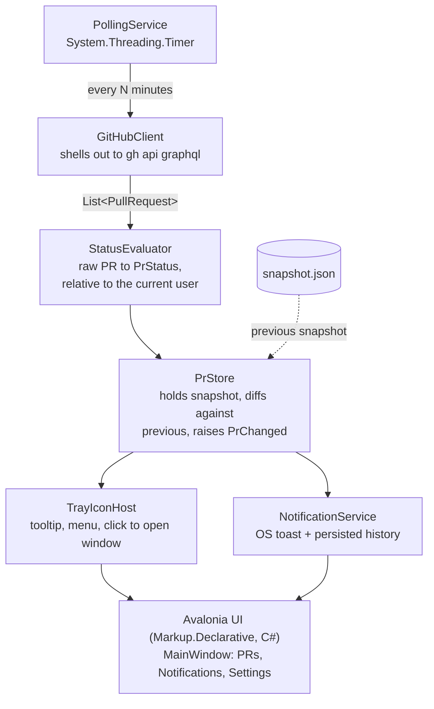

# Architecture & Plan

**GitHub PR Status Tracker** — a tray app that shows which pull requests are waiting on you.

This is a deliberately small app. The architecture below is intentionally light: one
process, one background poller, one in-memory state object, a few JSON files on disk.
There is no database, no plugin system, and no service layer beyond what is described here.

---

## 1. Shape of the app



Everything runs in one process. The poller is the only writer of app state; the UI reads
it and reacts to change events.

---

## 2. Project layout

```
src/PrStatusTracker/
  Program.cs                  // Avalonia entry point, single-instance guard
  App.cs                      // app lifetime, composition root, main window
  Assets/                     // tray icon PNGs: idle, needs-you, ready, error
  Models/
    PullRequest.cs            // raw data from GitHub
    PrStatus.cs               // status enum + bucket + labels
    NotificationRecord.cs
    AppSettings.cs
  GitHub/
    GhCommandRunner.cs        // Process wrapper around the `gh` executable
    GitHubClient.cs           // query + JSON to models
    Queries.cs                // the GraphQL document as a const string
  Core/
    StatusEvaluator.cs        // the rules in section 4
    PrFilter.cs               // main-window filter rules (text + author/label/repo)
    PrStore.cs                // snapshot + diffing
    PollingService.cs
    JsonFileStore.cs          // load/save for settings, snapshot, notifications
  Notifications/
    INotifier.cs              // + NullNotifier for other platforms
    WindowsNotifier.cs
    MacNotifier.cs
    NotificationService.cs    // filter, persist, dispatch
  Platform/
    IAutoStart.cs             // + Windows (HKCU Run key) and macOS (LaunchAgent) impls
    Browser.cs                // open a URL in the default browser
  Views/
    MainView.cs               // Avalonia.Markup.Declarative; tabs + shared helpers
    PrListView.cs
    NotificationsView.cs
    SettingsView.cs
    CompactWindow.cs          // the tray popup
    TrayIconHost.cs           // tooltip, icon variant, menu
  ViewModels/
    MainViewModel.cs
tests/PrStatusTracker.Tests/
  StatusEvaluatorTests.cs     // the rules tables, case by case
  PrFilterTests.cs
  PrStoreDiffTests.cs
  GitHubClientParseTests.cs   // parsing against Fixtures/graphql-response.json
  NotificationServiceTests.cs
```

**Wiring:** plain constructor injection, composed by hand in `App.cs`. No DI container —
there are about a dozen objects.

---

## 3. GitHub access via `gh`

All GitHub access goes through the `gh` CLI. The app never handles a token: `gh` already
holds the user's credentials, refreshes them, and respects their enterprise host config.

`GhCommandRunner` is a thin `Process` wrapper:

- Resolves the `gh` executable (`PATH`, then the usual install locations:
  `C:\Program Files\GitHub CLI\gh.exe`, `/opt/homebrew/bin/gh`, `/usr/local/bin/gh`).
- Runs with redirected stdout/stderr, no shell, a cancellation token, and a timeout.
- On non-zero exit, surfaces a typed failure. The three cases the UI cares about are
  **gh not installed**, **not authenticated** (exit code 4, or the message says so), and
  **rate limited / network error** (message text). Each maps to a specific banner in the
  window rather than a generic error.

### The one query

A single `gh api graphql` call fetches every list we need, using three `search` aliases in
one document. The viewer's login is fetched once at startup (`gh api user`) and cached,
since GraphQL search does not accept `@me`.

```graphql
query($reviewQ: String!, $reviewedQ: String!, $authoredQ: String!) {
  review:   search(query: $reviewQ,   type: ISSUE, first: 50) { nodes { ...PrFields } }
  reviewed: search(query: $reviewedQ, type: ISSUE, first: 50) { nodes { ...PrFields } }
  authored: search(query: $authoredQ, type: ISSUE, first: 50) { nodes { ...PrFields } }
}

fragment PrFields on PullRequest {
  number title url isDraft createdAt updatedAt additions deletions
  author { login }
  repository { nameWithOwner }
  labels(first: 10) { nodes { name } }
  reviewDecision                 # APPROVED | CHANGES_REQUESTED | REVIEW_REQUIRED | null
  mergeable                      # MERGEABLE | CONFLICTING | UNKNOWN
  reviewRequests(first: 20) { nodes { requestedReviewer {
    ... on User { login }
    ... on Team { name }
  } } }
  latestReviews(first: 20) { nodes { author { login } state submittedAt } }
  commits(last: 1) { nodes { commit {
    committedDate
    statusCheckRollup { state } # SUCCESS | FAILURE | PENDING | ERROR | EXPECTED
  } } }
}
```

with

- `reviewQ`   = `is:open is:pr review-requested:<login> archived:false`
- `reviewedQ` = `is:open is:pr reviewed-by:<login> -author:<login> archived:false`
- `authoredQ` = `is:open is:pr author:<login> archived:false`

`reviewed-by:` is there because GitHub removes a PR from `review-requested:` the moment you
submit a review; without it, approving a PR would look like the PR closing.

One call per poll keeps us well inside the GraphQL rate limit even at a one-minute
interval.

**Polling:** default every **2 minutes**, configurable (minimum 1 minute), plus a manual
*Refresh* in the tray menu. Failures double the interval per consecutive failure, capped
at 15 minutes, and the tray icon switches to its error variant; a success resets the
backoff.

**Opening a PR** hands the URL to the OS (`Process.Start` with `UseShellExecute`), which needs
no `gh` round trip. Future write actions (approve, comment) would go through `gh pr review`.

---

## 4. Status model

Each PR is reduced to one `PrStatus`, always expressed *relative to the current user*, and
each status belongs to a bucket that drives grouping and colour in the UI.

### PRs where you are a requested reviewer

| Condition | Status | Bucket |
|---|---|---|
| Draft | `ReviewerDraft` | Waiting on others |
| Requested personally, you have not reviewed | `AwaitingYourReview` | **Needs you** |
| Requested only through a team you belong to, not reviewed | `RequestedViaTeam` | **Needs you** |
| Review re-requested from you after you reviewed | `AwaitingYourRereview` | **Needs you** |
| You reviewed, then new commits were pushed | `NewCommitsSinceYourReview` | **Needs you** |
| Your latest review is `CHANGES_REQUESTED` | `YouRequestedChanges` | Waiting on others |
| Your latest review is `APPROVED` | `YouApproved` | Waiting on others |
| You only commented (or your review was dismissed) and are no longer requested | `YouCommented` | Waiting on others |

### PRs you authored

| Condition (first match wins) | Status | Bucket |
|---|---|---|
| Draft | `Draft` | Waiting on others |
| `mergeable == CONFLICTING` | `MergeConflict` | **Needs you** |
| Checks rollup is `FAILURE` or `ERROR` | `ChecksFailing` | **Needs you** |
| `reviewDecision == CHANGES_REQUESTED` | `ChangesRequested` | **Needs you** |
| `reviewDecision == APPROVED`, checks green | `ReadyToMerge` | **Ready to merge** |
| `reviewDecision == APPROVED`, checks pending | `ApprovedChecksPending` | Waiting on others |
| Reviewers requested, or anyone has reviewed, but no decision yet | `AwaitingReview` | Waiting on others |
| Nobody requested and nobody has reviewed | `NoReviewers` | **Needs you** |

A PR that appears in both lists (you authored it *and* were asked to review it) is shown
once, under the authored rules.

`NewCommitsSinceYourReview` compares your latest review's `submittedAt` against the head
commit's `committedDate` (GitHub no longer populates `pushedDate`). That comparison is what moves a PR back into **Needs you** when new
commits land, instead of leaving it stale at "you approved" — and tells you only the delta
needs a look. Within *Needs you* the status pill therefore answers *why* the PR needs you
(first look, team request, re-request, new commits; or for your own PRs: conflict, failing
checks, changes requested, no reviewers) rather than restating the bucket.

The three buckets — **Needs you**, **Waiting on others**, **Ready to merge** — are the
whole product in one line: the tray tooltip is just their counts.

---

## 5. Change detection & notifications

`PrStore` holds the current snapshot keyed by `repo#number`. After each poll it diffs the
new snapshot against the previous one and emits a change for:

- a PR **appearing** in either list (new review request, new PR of yours),
- a PR's **status changing** (`AwaitingReview` to `ChangesRequested`, `ChecksFailing` to
  `ReadyToMerge`, and so on),
- a PR **disappearing** from all three searches. That usually means merged or closed, but
  it can also mean a team review request was satisfied by a teammate, so the notification
  says "No longer on your list" rather than claiming a merge.

Rules that keep the noise down:

- The **first poll after launch is silent**. It seeds from the snapshot on disk, and only
  differences against that persisted snapshot notify.
- Only transitions *into* a notable status notify. Repeated polls with an unchanged status
  are silent. Statuses you caused yourself (`YouApproved`, `YouRequestedChanges`,
  `YouCommented`) and drafts you are requested on never toast.
- **One toast per poll.** Every change is recorded individually in history, but if a poll
  yields several, they are composed into a single toast — `N pull request updates` with up
  to four titles and `…and K more` — that opens GitHub's PR list. A lone change toasts as
  itself and opens that PR.

### Toasts

`INotifier.ShowAsync(Toast)` has one implementation per OS:

- **Windows** — the WinRT toast API, driven through a short Windows PowerShell script
  (`-EncodedCommand`). This avoids a Windows-only TFM and works with no installer: the toast
  is shown under PowerShell's own AUMID and uses protocol activation, so clicking it opens
  the PR URL. The packaging phase can swap this for `CommunityToolkit.WinUI.Notifications`
  with the app's own AUMID once there is an installer to register it.
- **macOS** — `osascript -e "display notification ..."`. This is the unsigned-build
  fallback; `UNUserNotificationCenter` (with click-through to the PR) needs a signed `.app`
  bundle and is deferred to packaging.

### Persistence

Three JSON files under the platform app-data directory
(`%LOCALAPPDATA%\PrStatusTracker\` on Windows,
`~/Library/Application Support/PrStatusTracker/` on macOS):

| File | Contents |
|---|---|
| `settings.json` | poll interval and notification prefs (start-at-login lives in the OS, not here) |
| `notifications.json` | rolling history, capped at 200: `Title`, `Body`, `Url`, `Timestamp`, `Dismissed` |
| `snapshot.json` | last PR snapshot, so a restart does not re-notify everything |

Writes are atomic (write to `.tmp`, then replace). A corrupt file is renamed aside and
recreated from defaults rather than crashing the app.

---

## 6. UI

Avalonia with **Avalonia.Markup.Declarative** — views are C# methods returning a control
tree; no XAML and no `.axaml` files in the project.

**Tray icon** — Avalonia's built-in `TrayIcon`:

- `ToolTipText` is rewritten after every poll with the summary line
  (`3 need you · 2 waiting · 1 ready to merge`). That is the hover behaviour.
- `Clicked` (left-click) toggles the **compact popup**. Avalonia's `TrayIcon` has no
  right-click event — right-click is reserved for the native menu — so the popup lives on
  left-click rather than right-click.
- Right-click menu: *Open main window*, *Refresh now*, *Open GitHub pull requests*, *Quit*.
- Four icon variants, drawn to be distinguishable at 16 px: grey ring (idle), orange with
  `!` (needs you), green with a check (ready to merge), red with `×` (error).

**Compact popup** (`CompactWindow`) — fixed 380×440, no window chrome, not resizable or
movable, pinned to the tray corner (bottom-right on Windows, top-right on macOS), hides
when it loses focus. A **segmented control** at the top switches between the three buckets
(`Needs you (13) · Waiting (5) · Ready (2)`; a segmented control rather than a dropdown so
the counts are visible and switching is one click), with the selected bucket's rows below
as single-line `[CI badge] title … age` entries, and *Open main window* / *Refresh* at the
bottom. The popup is never filtered — it shows the same unfiltered set the tray counts.

**Main window** — one window, a filter bar, and one tab per bucket plus two more.

The **filter bar** appears at the top of the *Needs you* and *Waiting on others* tabs —
the two that get long enough to need sifting; *Ready to merge* always shows everything.
Both tabs share one filter state: a free-text box (matches title, repo, author, labels and
`#number`, case-insensitively) and *Any author* / *Any label* / *Any repo* dropdowns whose
choices are rebuilt from the current snapshot on every poll (a still-valid selection
survives the rebuild). While a filter is active the tab headers read `Needs you (3 of 13)`
and a *Clear* button appears. The filter is view-only: the summary line, tray icon and
toasts always describe the unfiltered set. The rules live in `Core/PrFilter.cs` so they are
unit-tested without any UI.

Tabs:

1. **Needs you / Waiting on others / Ready to merge** — tab headers carry the count.
   Every PR list is sorted **oldest PR first** (by `createdAt`), regardless of status.
   Rows are two dense lines and the whole row is a button that opens the PR:
   `[CI badge] [status pill] Title … age` (the age turns bold, orange and gets an ⏳ once the
   PR has been open for more than 24 hours) over
   `repo#number · author · +adds −dels · ✓ approvals · ✗ changes · N awaiting · 🏷 labels · updated 2h ago`.
   The CI badge is text first (`✓ CI` passing, `✗ CI` failing, `… CI` running, `– CI` none)
   with colour as a secondary cue, so it reads without colour vision — the same reason the
   tray icons carry glyphs rather than relying on colour alone.
2. **Notifications (n)** — the persisted history, newest first, unread count in the header;
   each title is `<what happened> — <PR title>`. *Dismiss* per row, *Dismiss all*, and a
   *Show dismissed* toggle. Clicking a row opens the PR.
3. **Settings** — poll interval, start at login, which buckets should toast, `gh` status
   with a *Re-check* button, and the data directory as a link that opens it in
   Explorer / Finder.

The window icon is GitHub's own mark (`Assets/github.png`). Closing the window hides it to
the tray; quitting is explicit, from the tray menu.

---

## 7. Start at login

`IAutoStart` with `IsEnabled`, `Enable()`, `Disable()`:

- **Windows** — a value under `HKCU\Software\Microsoft\Windows\CurrentVersion\Run`
  pointing at the executable with a `--tray` argument.
- **macOS** — a LaunchAgent plist at `~/Library/LaunchAgents/com.prstatustracker.plist`
  with `RunAtLoad`, registered and unregistered with `launchctl`.

Both are per-user and need no elevation. The app starts hidden when launched with `--tray`.

---

## 8. Packaging

- **Windows** — self-contained `win-x64` publish wrapped in an installer that creates the
  Start Menu shortcut carrying the AUMID that toasts require.
- **macOS** — `osx-arm64` and `osx-x64` publishes bundled into a signed, notarized `.app`;
  signing is what makes native notifications work.

---

## Implementation plan

Each phase ends with something runnable.

1. **Skeleton** — Avalonia app with Markup.Declarative, tray icon, empty window,
   single-instance guard, hide-to-tray. *Runnable: an icon in the tray.*
2. **`gh` integration** — `GhCommandRunner`, `GitHubClient`, the GraphQL query, the models,
   and the three error cases. *Runnable: the window lists raw PRs.*
3. **Status model** — `StatusEvaluator` plus unit tests over fixture JSON, driven by the
   tables in section 4. *Runnable: PRs grouped into the three buckets.*
4. **Polling & tooltip** — `PollingService`, `PrStore`, backoff, tooltip summary, manual
   refresh. *Runnable: the app is already useful.*
5. **Notifications** — diffing, `NotificationService`, Windows toasts, then macOS toasts,
   persistence, and the Notifications tab. *Runnable: it tells you when things change.*
6. **Settings & autostart** — settings file, settings tab, `IAutoStart` on both platforms.
7. **Packaging** — installer, `.app` bundle, signing and notarization.

### Progress

Phases 1–6 are implemented and the app runs against live data on Windows. Phase 7
(packaging, signing, notarization) has not started. macOS code paths compile but have not
been run on a Mac.

### Known unknowns

- ~~**Team review requests.**~~ Confirmed: `review-requested:<login>` returns PRs where only
  a team the user belongs to was requested, so a single search is enough.
- **macOS notifications outside a bundle.** The `osascript` path is what ships in dev
  builds; whether it is good enough day-to-day is still to be judged on a Mac.
- ~~**`statusCheckRollup` is `null` on PRs with no checks.**~~ Handled: `null` maps to "no
  checks", which counts as green for *Ready to merge*. Covered by a unit test.
- **Snapshot age on the tray.** `PrItemViewModel.Age` is computed when the snapshot is
  applied, so it goes stale between polls; fine at a 2-minute interval, worth a timer if
  the interval is raised.
