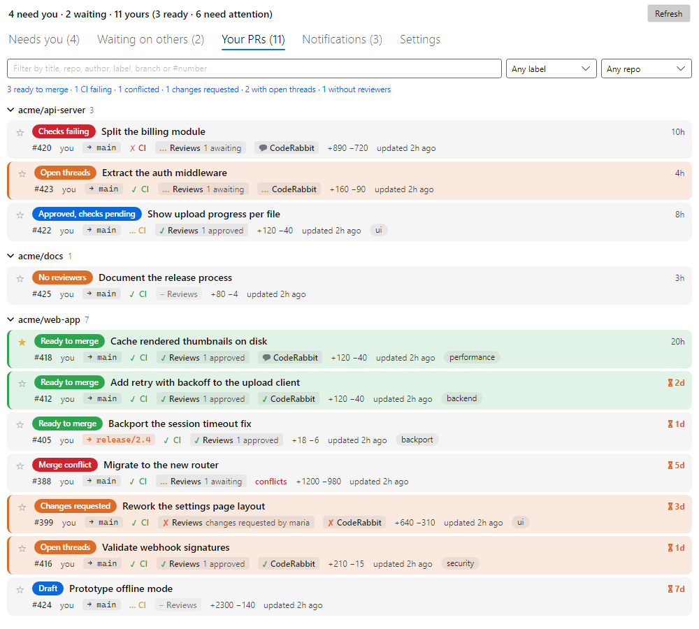
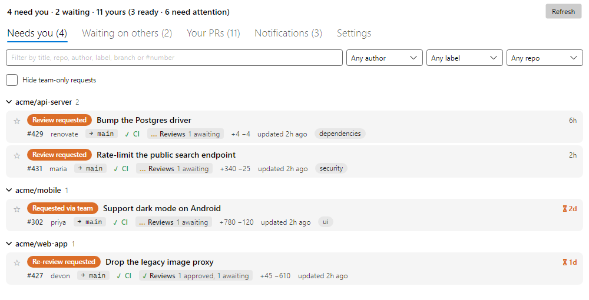
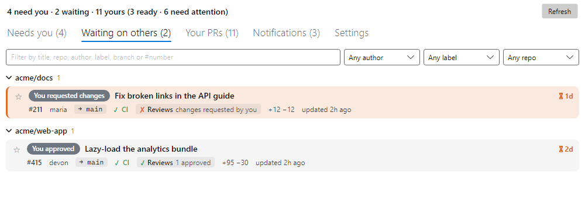
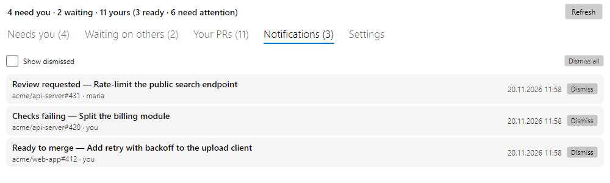

# PR Status Tracker

A tray app for Windows and macOS that answers one question without opening a browser:
**which pull requests are waiting on me right now?**



It reads GitHub through the [GitHub CLI](https://cli.github.com/), so it has no token or
credentials of its own. It polls every 2 minutes, sorts every open PR you are involved in into
three tabs, and sends a native notification when one of them changes in a way that needs you.

## Install

1. Install the [GitHub CLI](https://cli.github.com/) 2.21.0 or later and sign in once:

   ```bash
   gh auth login
   ```

2. Download the installer for your system from the
   [latest release](https://github.com/sensslen/github-pr-status-tracker/releases/latest):

   | System | File |
   |---|---|
   | Windows 10 1809+ | `PrStatusTracker-<version>-win-x64-setup.exe` |
   | macOS 12+, Apple Silicon | `PrStatusTracker-<version>-osx-arm64.dmg` |
   | macOS 12+, Intel | `PrStatusTracker-<version>-osx-x64.dmg` |

   The Windows installer runs for the current user and needs no administrator. It is unsigned, so
   SmartScreen asks first: choose **More info**, then **Run anyway**.

   On macOS, open the disk image and drag the app to Applications. The app is signed ad hoc, so
   macOS asks before the first launch: choose **Open Anyway** under **System Settings > Privacy &
   Security**, or clear the download flag once:

   ```bash
   xattr -dr com.apple.quarantine "/Applications/PR Status Tracker.app"
   ```

3. Turn on **Start at login** under *Settings* to have it start hidden in the tray.

### Updates

The app checks for a newer release once a day and offers it in the window header and under
*Settings > Updates*. On Windows, accepting installs it silently and restarts the app. On macOS it
opens the new disk image for the drag to Applications.

> **Moving from the renewedvision repository:** releases up to v0.0.3 came from
> `renewedvision/github-pr-status-tracker`, which is now archived and read-only. Those builds
> cannot update themselves, so install v0.1.0 or later by hand once. From then on, updates come
> from this repository. Your settings, stars and notification history stay.

## The tabs

| Tab | What is in it |
|---|---|
| **Needs you** | Other people's PRs that want your review: requested from you or a team you are on, re-requested, or with new commits since your review. *Hide team-only requests* drops the team ones. |
| **Waiting on others** | PRs you have reviewed where the next move is someone else's: you approved, requested changes, or commented. |
| **Your PRs** | Everything you authored, whatever its state, with a strip above the rows counting what wants attention (screenshot at the top). |
| **Notifications** | Every notification the app has sent, kept until you dismiss it. |
| **Settings** | Poll interval, which changes notify you, start at login, the `gh` check, and updates. |





Every tab groups PRs by repository. Click a header to collapse it; the app remembers collapsed
sections across restarts. Within a repository, starred PRs come first, then the ones calling for
something, then the rest, oldest first. Click any row to open the PR in the browser.

## Reading a card

Each card shows the PR's status as a pill, then a row of chips:

- **Target branch.** `→ main`, orange when the PR merges somewhere other than the default branch,
  such as a release branch or another PR's branch. The tooltip names the source branch.
- **CI.** ✓ green, ✗ failing, … pending.
- **Reviews.** Where the people stand: ✓ approved, ✗ changes requested (naming who), … waiting,
  💬 comments only, – nobody asked. The tooltip says who said what. A change request still counts
  after you re-request that reviewer, because GitHub keeps blocking the merge until they answer.
- **CodeRabbit.** Its own chip with the same symbols, so a bot approval never reads as a person's.
- **conflicts**, the size of the change, when it was last updated, and its labels.
- **⌛ age**, orange once the PR has been open for more than a day.

Card colour says what the PR wants from you:

- **Green**: ready to merge, approved by a person rather than only CodeRabbit, into the default
  branch.
- **Orange**: something you can act on. A review thread waits on your reply, or a reviewer
  requested changes and you have not asked them to look again.
- **Plain**: everything else, including a ready PR into a non-default branch.

### Statuses on your own PRs

| Pill | Meaning |
|---|---|
| Ready to merge | Approved, checks green, nothing outstanding |
| Approved, checks pending | Approved, CI still running |
| Open threads | A review thread waits on your reply, or the PR is otherwise ready and an unresolved thread blocks the merge |
| Checks failing | CI is red |
| Merge conflict | The branch no longer merges cleanly |
| Changes requested | A reviewer asked for changes |
| Awaiting review | Reviewers asked, no decision yet |
| No reviewers | Nobody asked and nobody has reviewed |
| Draft | Still a draft |

A thread waits on your reply while it is unresolved and its last comment is from someone else,
bots included. An approved, green PR with any unresolved thread, even one waiting on the
reviewer, shows *Open threads* instead of *Ready to merge*, because a branch that requires
conversation resolution will not merge it. Every poll reads the current thread state from GitHub.

[ARCHITECTURE.md](ARCHITECTURE.md#4-status-model) has the full rules, including the reviewer side.

## Tray and notifications



| Action | Result |
|---|---|
| Hover the tray icon | Summary, such as `3 need you · 2 waiting · 7 yours (1 ready · 2 need attention)` |
| Click the tray icon | Opens the main window |
| Right-click the tray icon | Open, refresh, open GitHub, quit |
| Close the window | Hides it to the tray; quit from the tray menu |
| Click a notification | Opens the PR, or GitHub's PR list when one poll changed several |

The tray icon has its own look for "something needs you", "a PR is ready to merge" and "polling
failed". A poll sends at most one notification, however many PRs changed.

## Filtering and stars

The filter bar matches title, repository, author, label, target branch and `#number`, with
dropdowns for author, label and repository. *Needs you* and *Waiting on others* share one filter;
*Your PRs* has its own. Filters never change the tray summary.

Click ☆ to star a PR. Starred PRs sort to the top of their repository and stay starred across
restarts. Stars are local; nothing is sent to GitHub.

## Building from source

Needs the [.NET 10 SDK](https://dotnet.microsoft.com/download). The commands are the same on
Windows and macOS.

```bash
dotnet build
dotnet test
dotnet run --project src/PrStatusTracker            # opens the window
dotnet run --project src/PrStatusTracker -- --tray  # starts hidden in the tray
```

CI builds and tests every pull request on Windows and macOS (`.github/workflows/ci.yml`). A build
from source has version 0.0.0 and is never offered an update.

### Publishing

A Release publish with a runtime identifier produces a NativeAOT build that needs no .NET install,
about 37 MB, in `src/PrStatusTracker/bin/Release/net10.0/<rid>/publish/`:

```bash
dotnet publish src/PrStatusTracker -c Release -r win-x64     # or osx-arm64, osx-x64
```

NativeAOT links with the platform C++ toolchain: the Visual Studio *Desktop development with C++*
workload on Windows, the Xcode command-line tools on macOS. Without it, pass
`-p:PublishAot=false` for a single-file build that carries the .NET runtime.

### Releasing

Push a `vX.Y.Z` tag. `.github/workflows/release.yml` builds the Windows installer and both macOS
disk images and publishes them as a GitHub release; a tag with a `-` suffix becomes a prerelease,
which the updater ignores. Nothing is signed or notarized.

To package by hand from a publish directory:

```bash
# Windows, NSIS 3. Both paths must be absolute.
makensis /DVERSION=1.2.3 /DFILEVERSION=1.2.3.0 \
         /DSOURCE=<publish dir> /DOUTFILE=<setup.exe path> \
         packaging/windows/installer.nsi

# macOS
packaging/macos/make-bundle.sh <publish dir> 1.2.3 "PR Status Tracker.app"
```

`packaging/icon/make-icons.py` regenerates both platforms' icons from the app's window icon.

### Screenshots

The images in `docs/screenshots` are rendered headless from the app's own views over made-up
data, so they never show real pull requests:

```bash
dotnet run --project tools/Screenshots
```

Edit `tools/Screenshots/Program.cs` to change the demo PRs.

## Tech stack

C# on .NET 10, [Avalonia](https://avaloniaui.net/) with
[Avalonia.Markup.Declarative](https://github.com/AvaloniaCommunity/Avalonia.Markup.Declarative)
for the UI in C# rather than XAML, and `gh api graphql` for all GitHub access.
[ARCHITECTURE.md](ARCHITECTURE.md) covers the design, the status model and the data flow.
